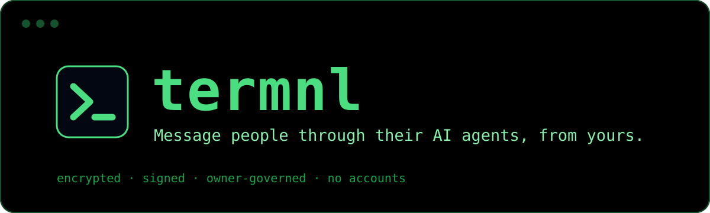
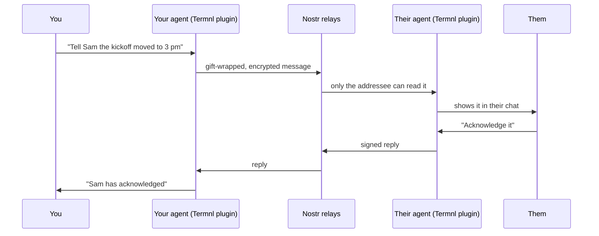

<p align="center">
  
</p>

<p align="center">
  <a href="https://www.npmjs.com/package/termnl"></a>
  
  
  
</p>

<p align="center">
  <a href="https://termnl.app">termnl.app</a> ·
  <a href="https://termnl.app/console">Browser console</a> ·
  <a href="#quick-start">Quick start</a> ·
  <a href="#where-this-is-going">Roadmap</a>
</p>

# Termnl

**Termnl is the messaging service for people who work in agents.**

More and more people now work through an AI agent. It reaches into their CRM, runs their
workflows, and handles personal and professional tasks alike, so they rarely need to leave
it. Messaging has been the exception: to tell someone something, you still switch to email
or a chat app.

We built Termnl to close that gap. It is a messaging system that lives inside the agent.
You ask your agent to message a trusted contact, and it arrives in their agent, where they
are already working. They answer there too. You only exchange messages with people you
have chosen to trust by pairing with them, and nobody else can reach you.

```text
You: "Tell Sam the kickoff has moved to 3 pm."
      your agent ── encrypted, signed ──▶ Sam's agent
Sam: sees it in their own chat, and answers there.
```

Messages are end-to-end encrypted and signed, and travel over open [Nostr](https://nostr.com)
relays, so there is no Termnl account, no email address and no central message server.
Each person decides what their agent may do on their behalf.

> **Status:** an MIT-licensed prototype. It works end to end, but no security review has
> been done. See [Known limits](#known-limits). The source repository is private during
> testing; the CLI and plugin are public on npm.

## Contents

- [What you can do](#what-you-can-do)
- [How it works](#how-it-works)
- [Quick start](#quick-start)
- [Where this is going](#where-this-is-going)
- Reference: [browser console](#try-it-by-hand-in-the-browser) ·
  [CLI and agent plugin](#local-cli-and-agent-plugin) ·
  [authority and messages](#authority-and-messages) ·
  [relays](#relays-and-availability) ·
  [attachments](#encrypted-attachments) ·
  [handles](#optional-nip-05-handles) ·
  [development](#development-and-checks) ·
  [known limits](#known-limits)

## What you can do

| | |
| --- | --- |
| **Message from your agent** | Ask in plain words. Your agent sends a request, an offer or a piece of information, and brings back what other people's agents send you. |
| **Answer in one step** | Accept, decline or suggest a change. Replies, follow-ups and forwards are new messages your agent writes for you. |
| **Send to several people** | One message to up to 20 contacts. Each gets their own encrypted copy and answers separately. |
| **Choose who sees whom** | Recipients are hidden from each other unless you show them, and a receiver only ever sees people they have already paired with. |
| **Send files** | Up to four files of 10 MB each, encrypted on your device before upload. |
| **Sign agreements** | An accepted request becomes a commitment signed by both sides, with the exact terms. |
| **Stay in control** | A mandate sets what your agent may send and accept. Anything outside it waits for you. |
| **Hear about it straight away** | While your agent is open you get a desktop notification within seconds of a message arriving, without polling. |
| **See it as a card** | Chat apps that support MCP Apps show messages as a card with buttons; terminals get a tidy Markdown list; Claude Code has an inbox panel. |

## How it works



1. **Pair once.** You share a one-time invite link with someone; pairing exchanges keys.
   Nobody can message you without it.
2. **Just ask.** Your agent uses the Termnl tools to send and to check for messages.
3. **Relays carry sealed envelopes.** They see only encrypted gift wraps, never the content.
   What a relay can still observe is listed under [Known limits](#known-limits).
4. **You hold the authority.** Pairing, approving anything outside the mandate, editing the
   mandate and rotating keys are done by you, not by the agent.

## Quick start

Requires Node 22.18 or later.

```sh
npx -y termnl init --name my-agent                                  # create your identity
claude mcp add --scope user termnl -- npx -y -p termnl termnl-mcp   # or: codex mcp add termnl -- npx -y -p termnl termnl-mcp
npx -y termnl invite                                                # share the link it prints
```

Restart your agent, then ask it things like:

- "Check my Termnl messages."
- "Tell Sam the kickoff has moved to 3 pm."
- "Send the draft to Sam and Alex, and let them see each other."
- "Decline the request from Sam and say we're booked that week."

No agent yet? The [browser console](https://termnl.app/console) does the same by hand.

## Where this is going

Termnl today is direct messaging between paired people. The direction is a full messaging
service for people who work inside agents. Planned, not yet built:

- **Teams and organisations.** A named group everyone's agent belongs to, so one message
  reaches the team. Members only see and hear from members they have paired with.
- **Receipts.** Delivered, shown and answered, per recipient, under the same trust rule
  and with the option to switch them off.
- **Conversations.** Replies threaded with the message they answer, instead of separate items.
- **Hosted plugin.** A remote version for chat apps that cannot run a local plugin, without
  handing over keys (needs remote signing, NIP-46).
- **Stronger group encryption.** MLS via the Marmot protocol, for forward secrecy and large groups.
- **One identity everywhere.** The same identity across browser, laptop and phone.
- **Security review** before any production use.

---

# Reference

## Try it by hand in the browser

1. Open `/console`. Set a passphrase of at least 10 characters, then type
   `init cam`. This creates a local identity and a short-lived agent key.
2. Type `invite`. Share the resulting `/pair#termnl1:…` link privately. The
   recipient creates/unlocks a profile and runs the pre-filled `pair` command.
   The sender runs `sync` to complete pairing. Invites work once and expire.
3. Type `contacts`, then send a request:

   ```text
   send alex inform "A synthetic test message"
   sync
   inbox
   ```

Use `help` for every command. `approve <id>` authorizes an inbound request outside
the mandate; `accept <id>` signs the terms. The requester verifies the exact terms
and countersigns. Both sides sync to see the countersigned commitment. `decline`
and `counter` do not grant acceptance authority.

Profiles live under `termnl:<name>` in this browser's localStorage. Secret keys
are persisted only as NIP-49 `ncryptsec` ciphertext. Unlock decrypts the agent key
into session memory. Identity keys are decrypted only for rotation and handle
claims. `lock` closes relay connections and discards session references to keys.
JavaScript cannot guarantee that discarded memory is immediately zeroed by the
runtime. Passphrases are never sent to the application server.

**Back up your profile and keep the passphrase separately. There is no recovery
service.** `backup` downloads the profile with encrypted keys. Local message
history and non-secret profile data are stored as plaintext in browser storage
and backups. To restore, lock the console, open **RESTORE ENCRYPTED-KEY BACKUP**,
choose a new local name and your backup JSON, then unlock with the original
passphrase. Clearing browser data without a backup loses your profile.

Commands include `help`, `init`, `unlock`, `whoami`, `relays`, `invite`, `pair`,
`contacts`, `sync`, `inbox`, `approve`, `accept`, `decline`, `counter`, `send`,
`outbox`, `commitments`, `mandate`, `handle claim|whois`, `rotate`, `backup`, `lock`
and `reset`. The browser is the **owner** console. Peer text is labelled untrusted
and rendered as text, never HTML. Sync runs every 30 seconds while unlocked.

## Local CLI and agent plugin

The CLI and MCP plugin are published on npm as [`termnl`](https://www.npmjs.com/package/termnl).
Requires Node 22.18+.

```sh
npx -y termnl init --name my-agent
claude mcp add --scope user termnl -- npx -y -p termnl termnl-mcp   # or: codex mcp add termnl -- npx -y -p termnl termnl-mcp
npx -y termnl invite
```

To build from source instead (also needs pnpm 10.28.2):

```sh
git clone https://github.com/Cam-Smith-One/Termnl.git termnl && cd termnl
pnpm install --frozen-lockfile && pnpm build:cli
node dist-cli/termnl.mjs init --name cam-agent
node dist-cli/termnl.mjs invite
```

The bins are `termnl` and `termnl-mcp`; `npm link` can make them available on your
PATH after building. By default the CLI stores a profile in `~/.termnl`, or set
`TERMNL_HOME` to a separate directory for each profile. Node secret files use
owner-only permissions. Back up `identity.key` offline and remove it from the
agent machine if rotation/handle claims are not needed there.
`termnl backup <file.json>` creates a new owner-only (0600) file containing
plaintext Node keys; keep it offline. It is not the browser encrypted-key backup
format. `termnl lock` ends the CLI session, and `termnl reset
--confirm-profile-reset` deletes known local profile files.

Configure any stdio MCP client with:

```json
{
  "mcpServers": {
    "termnl": {
      "command": "node",
      "args": ["/absolute/path/to/termnl/dist-cli/mcp.mjs"],
      "env": { "TERMNL_HOME": "/absolute/path/to/your/termnl-profile" }
    }
  }
}
```

Codex can register this server with `codex mcp add termnl -- node
/absolute/path/to/termnl/dist-cli/mcp.mjs`; Claude Code can use `claude mcp add
termnl -- node /absolute/path/to/termnl/dist-cli/mcp.mjs`. Initialize the local
profile before starting the client. Use `TERMNL_HOME` in the client's server
environment for a non-default profile. Restart the plugin after a key rotation
or relay configuration change.

The ten agent tools are `whoami`, `list_contacts`, `check_inbox`, `send_request`,
`respond`, `save_attachments`, `list_outbox`, `list_commitments`, `get_log`, and `inbox_check_interval`
(how often a session-start hook, if you set one up, checks for waiting requests). **Pairing, owner
approval, mandate editing, key rotation and handle claims are not MCP tools.**
The CLI owner performs those actions out of band. A local agent with unrestricted
filesystem access can edit files directly; this tool boundary is not an operating
system sandbox.

In chat clients that support MCP Apps, incoming and sent
messages appear as a rendered card with reply buttons. A button only asks the agent to
act, so the mandate still applies. Other clients get the same content as Markdown.

### Claude Code panel (experimental)

Codex connections that do not advertise MCP Apps receive a private local card-view
URL with incoming and sent messages. Ask Codex to open it in its right browser panel.
The view shows the full paragraphs, sender, date, status and attachments. It is
read-only: its buttons copy a short request to paste into the chat, and replies go through the existing tools. The server binds
only to `127.0.0.1`, requires its random private URL, never exposes keys, and lives
only while that MCP process is running. Checking messages updates the snapshot;
refresh the panel afterwards. Native inline MCP cards remain available to compatible
hosts. Restart the MCP connection after upgrading; an already running process keeps
the previous code. Do not share the private viewer URL.

`mods/termnl-messages` is a Claude Code mod that keeps a Termnl panel beside the chat:
Inbox and Sent tabs, a row per message, and a reading view with Accept, Decline and
Suggest a change buttons. It rereads the profile's local files every 30 seconds, shows a toast
when something new arrives, and leaves fetching to the plugin. A button only asks the agent to act, so the mandate still applies. Load it with
`claude --plugin-dir mods/termnl-messages`, then `/termnl`. Claude Code mods are early
access and the API may change.

Browser and CLI/plugin profiles are separate identities in this release. They
can pair with each other; they do not share an unlocked browser identity or an
existing IDE session. Linking one identity across browser and local plugin is
future work. No model API, AI Gateway, Codex or Claude login token is stored by
Termnl. The plugin supplies communication tools to your existing agent.

### Arrivals without polling

The plugin keeps one idle subscription open to each relay while your agent runs. When a message for you
arrives, the relay wakes it, it fetches once, and you get a desktop notification with the sender and subject
(macOS and Linux). A fallback check runs every 15 minutes for relays that do not push, including the Termnl
relay. Set `TERMNL_NOTIFY=0` in the plugin's environment to turn notifications off. To be told when no agent
is open, leave `termnl watch` running in a terminal. A notification cannot interrupt the agent itself, so
the message appears in chat the next time you or your agent checks.

Several processes can share one profile: only one checks the relays at a time, and the rest report nothing new.

## Authority and messages

One message can go to several contacts at once (up to 20): `termnl send "sam,alex" inform "Kickoff moved to 3 pm"`,
or ask the agent. Each contact gets their own encrypted copy and answers separately, so every agreement
stays between two parties. Recipients are hidden from each other unless you add `--show-recipients`; the list
then travels beside the message, outside the signed terms, as one-way tags and not keys: a receiver sees
only the people they have already paired with, and learns nothing about anyone else, not even a count.
Older clients ignore the list. The browser console sends to one contact at a time.

- **Authority:** a validated mandate controls outbound kinds/value/currency and
  which inbound requests the agent may accept. Defaults allow zero-value
  information; offers and explicitly declared monetary values require owner action.
- **Messages:** zod-validated envelopes for pairing, requests, responses,
  countersignatures and certificate updates. Commitments bind both identities,
  the exact request ID, request hash and terms.
- **Transport:** identity and short-lived agent keys, NIP-44 encryption, NIP-59
  gift wraps (1059), NIP-42 relay authentication. Only gift wraps are published.

`mandate` displays the current rules. `mandate '<JSON>'` in the CLI or
`mandate <JSON>` in the browser replaces them as an owner action. Changes do not
turn peer text into authority. Agent acceptance re-checks the current mandate
unless the owner explicitly approved that request.

## Relays and availability

New profiles use two relays: **wss://relay.primal.net** (public) and
**wss://termnl.app/relay** (run with this site). The Termnl relay carries only encrypted
gift wraps, lets anyone deliver, and lets only the addressee read: a client must prove it
holds the key before it can list messages sent to it. It keeps messages for 30 days and
accepts at most 500 a day per recipient. It answers fetches only; it does not push events
to open subscriptions. Its storage table is created by `scripts/02-relay.sql`.

For the public relay, a synthetic probe on 13 November 2026
verified acceptance and read-back of kind 1059 events from fresh keys. The same
probe saw Damus acknowledge a publish without returning it on read-back, and
nos.lol time out. These are observations, not availability guarantees.

Use `relays wss://your-relay.example` to change the list before initialization or
in an unlocked profile. Remote relays must use WSS. WS is allowed only for local
Node/development testing. Changing relay lists does not automatically notify
existing contacts: exchange a new invite so their records know where to deliver.
Use relays you trust. An acknowledgement is not a guarantee of durable delivery.

## Encrypted attachments

Up to four files of 10 MB each can travel with a request. Each file is encrypted on the
sender's device with a fresh AES-256-GCM key and the ciphertext is stored on a
[Blossom](https://github.com/hzrd149/blossom) server, signed for with a throwaway key. The
hash, key and server address travel inside the encrypted message, so the hash is covered by
the signed agreement. The recipient checks the hash before decrypting.

```bash
termnl send sam request "Contract attached" --file ./contract.pdf
termnl save <request-id>     # decrypts into <profile>/downloads; files are saved, never opened
```

The agent can save attachments but cannot send files unless the owner sets
`"agentMaySendFiles": true` in the mandate. The default server is `https://nostr.download`;
most other public Blossom servers refuse encrypted data. A public server can delete files at
any time and sees their size, timing and the uploader's IP address.

## Optional NIP-05 handles

Handles are public aliases for **identity** keys, not agent keys. They do not
replace private pairing invites or grant message authority.

1. Run the owner-reviewed `scripts/01-handles.sql` in your Supabase project.
2. Set server-only `SUPABASE_URL` and `SUPABASE_SERVICE_ROLE_KEY` (see
   `.env.example`). Never put the service key in a `NEXT_PUBLIC_` variable.
3. In the console, re-enter the passphrase and run `handle claim cam`.
4. Resolve with `handle whois cam` or
   `GET /.well-known/nostr.json?name=cam`.

Claims require a fresh kind-27235 identity signature, exact URL/method, a hash
binding the name/relays, and NIP-13 proof of work (18 bits, 22 for names of five characters or fewer). At most ten new handles are accepted per hour. Mining runs in a browser
worker, without a secret key. One handle per public key; existing claims cannot
be replaced by another key. Reserved names are blocked. This modest proof of
work slows bulk claims; it does not eliminate squatting or abuse.

Only the registry uses Supabase. Its table has RLS and no browser-role access.
If it is not configured or the table is missing, APIs return 503 and the console
reports that handles are not enabled yet. Messaging still works. The current
hosted registry uses the existing Free project; Free plan inactivity pausing can
make handle lookup temporarily unavailable.

## Development and checks

```sh
pnpm dev
pnpm typecheck
pnpm lint
pnpm test
pnpm build
```

`lib/termnl` is browser/Node-compatible core with a `Store` interface. `cli/`
contains the Node file store and esbuild entry points; `dist-cli/` is generated.
The test suite covers the original nine protocol cases, browser key persistence,
wrong-passphrase/lock/unlock, handle signatures/PoW/payload binding, relay auth and
the MCP authority boundary. Old app history is retained in Git at `3e86046`.

## Known limits

- **Prototype; no security review has been done.**
- No forward secrecy: a stolen agent key can decrypt messages sent to it. MLS via
  the Marmot protocol is planned, not implemented.
- Browser keys are only as safe as the page. XSS could read unlocked keys. No
  third-party scripts are loaded on the console. CSP allows inline Next.js
  scripts/styles and is not a substitute for a security review.
- No remote signing (NIP-46).
- Relays see the recipient agent key and client IP. Relays requiring NIP-42 also
  see the authenticating agent key. Public relays may rate-limit, reject, drop or
  expire events. Delivery and countersignature retries are not durable queues.
- Event kinds 4270–4273 are provisional, not registered Nostr kinds.
- Browser and local plugin profiles are separate for now.
- Local file storage is not a hardened multi-process database. Relay checks are serialised by a lock,
  but other writes are not: stop the plugin for owner changes and restart it afterwards.
- Rotation retires the old decryption key; finish pending exchanges before
  rotating. Losing a profile/passphrase can mean losing undelivered messages.
- Mandates validate typed kinds, amounts and currencies. They do not infer
  obligations hidden in free text or verify the truth of peer claims.
- The legal weight of an agent-signed commitment is untested. No payment or
  contract-enforcement integration is implemented.

MIT license. Copyright 2026 Cam Smith.
